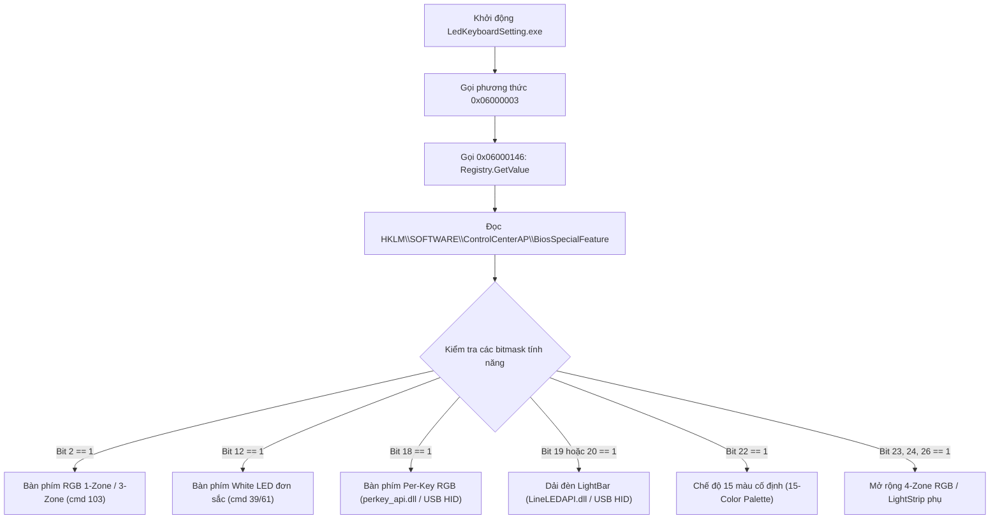

# Báo Cáo Phân Tích Kỹ Thuật Tĩnh: Gói Điều Khiển Đèn Bàn Phím (LedKeyboardSetting)

> **Mục tiêu phân tích:** `CC\LedKeyboardSetting.exe` và các thư viện liên kết (`InsydeDCHU.dll`, `perkey_api.dll`, `LineLEDAPI.dll`, `DataAddress.dll`, `Windowshook.dll`, các file `.ini`, `.xml`) trong thư mục `D:\03_Videcoding\REA-ControlCenterGiGaByte-LinuxNoBara\src\installed\LedKeyboardSetting`.  
> **Mục đích:** Cung cấp đầy đủ thông số kỹ thuật, luồng nhận diện phần cứng, định dạng gói tin, và công thức đóng gói bitwise để phục vụ xây dựng driver / daemon điều khiển bàn phím trên Linux (NoBara).  
> **Quy tắc phân tích:** 100% phân tích tĩnh (Static Reverse Engineering) bằng bộ công cụ REA và kiểm tra cấu trúc CIL/PE, không chạy file nhị phân mục tiêu.

---

## 1. Kiểm Kê Các File Cấu Hình & Thành Phần Trong Gói

### 1.1 Thư mục `LedKeyboardSetting\CC`
| Tên file | Kích thước (bytes) | Định dạng / Loại | Vai trò kỹ thuật |
| :--- | :--- | :--- | :--- |
| `LedKeyboardSetting.exe` | 15.461.376 | PE32+ (x86_64) CIL .NET Assembly | **Ứng dụng chính** điều khiển đèn bàn phím (SHA-256: `2b50e58e64ac30c4aca16be554665c539c31a3ff9312c51815e3f24194211570`). Nhắm mục tiêu `.NET Framework 4.6.1`. Bị obfuscate bằng ConfuserEx/Babel (mã hóa chuỗi động qua token `0x06000128`). |
| `LedKeyboardSetting.exe.config` | 231 | XML Config | Cấu hình runtime .NET: khai báo runtime hỗ trợ `<supportedRuntime version="v4.0" sku=".NETFramework,Version=v4.6.1"/>`. |
| `mtlanguage.ini` | 341.708 | INI Configuration | Chứa 5.202 dòng chuỗi đa ngôn ngữ (en-us, zh-tw, zh-cn, de, fr, ja, v.v.). Định nghĩa tên các chế độ hiệu ứng đèn: `_BreatheMode=Breathe Mode`, `_CycleMode=Cycle Mode`, `_WaveMode=Wave Mode`, `_DanceMode=Dance Mode`, `_TempoMode=Tempo Mode`, `_FlashMode=Flash Mode`, `_RandomMode=Random Mode`. |
| `InsydeDCHU.dll` | 2.492.416 | PE32+ (x86_64) Native DLL | Cầu nối giao tiếp phần cứng qua ACPI/WMI và Clevo/Insyde DCHU Driver. Cung cấp các P/Invoke: `GetDCHU_Data_Integer`, `GetDCHU_Data_Buffer`, `SetDCHU_Data`, `SetDCHU_DataEx`, `ReadAppSettings`, `WriteAppSettings`. |
| `perkey_api.dll` | 116.736 | PE32+ (x86_64) Native DLL | Thư viện USB HID trực tiếp giao tiếp với vi điều khiển phím Per-Key RGB (ITE IT8910: `VID_048D&PID_8910`). Exports: `InitPerkeyIo`, `SetLEDStatus`, `GetLedData`, `SetLEDStatusAll`. |
| `LineLEDAPI.dll` | 147.968 | PE32+ (x86_64) Native DLL | Thư viện USB HID trực tiếp điều khiển dải đèn LED / LightBar (ITE IT8297: `VID_048D&PID_8297`). Exports: `InitLineLEDIo`, `SetLEDStatus`, `GetLedData`, `GetInfo`, `SetLEDMode`, `SetLightBarData62`. |
| `DataAddress.dll` | 204.800 | PE32+ (x86_64) Native DLL | Hỗ trợ ánh xạ địa chỉ bộ nhớ chia sẻ / inter-process. |
| `Windowshook.dll` | 13.824 | PE32+ (x86_64) Native DLL | Cài đặt hook cửa sổ Windows và phím tắt bàn phím. |

### 1.2 Thư mục gốc `LedKeyboardSetting\`
| Tên file | Kích thước (bytes) | Vai trò |
| :--- | :--- | :--- |
| `AppxManifest.xml` | 3.035 | Manifest UWP Desktop Bridge (`CLEVOCO.LedKeyboardSetting` v`7.68.0.0`). Định nghĩa protocol scheme `clevokeyboard:` và quyền `runFullTrust`. |
| `AppxBlockMap.xml` | 23.892 | Bảng mã băm SHA-256 các block của gói AppX. |
| `AppxSignature.p7x` | 12.187 | Chữ ký số của gói ứng dụng Clevo/Gigabyte. |
| `resources.pri` | 1.672 | File chỉ mục tài nguyên nhị phân Windows Package Resource Index. |

---

## 2. Cơ Chế Nhận Diện Loại Bàn Phím (Keyboard Type Detection)

Khi khởi chạy, `LedKeyboardSetting.exe` tự động phát hiện khả năng phần cứng của bàn phím thông qua phương thức khởi tạo **`0x06000003`** thuộc Type **`\u0002 `** (`0x02000003`).



### 2.1 Luồng truy vấn Registry & WMI
1. **Khởi tạo dịch vụ nền:** `DCHUService.exe` gửi lệnh WMI `cmd = 122` (`0x7A`: `BiosSpecialFeature`) xuống BIOS/EC để truy vấn mặt nạ bit tính năng phần cứng của model máy.
2. **Lưu trữ Registry:** Giá trị số nguyên 32-bit này được lưu vào:
   - **Key:** `HKEY_LOCAL_MACHINE\SOFTWARE\ControlCenterAP`
   - **Value:** `BiosSpecialFeature` (hoặc `BIOS_special_feature_list`).
3. **Đọc cấu hình:** Trong `LedKeyboardSetting.exe`, phương thức `0x06000146` gọi `Microsoft.Win32.Registry::GetValue` để lấy giá trị số nguyên này và chuyển đổi bằng `Convert.ToInt32()`.

### 2.2 Giải mã chi tiết từng Bitmask trong `0x06000003`
Trong CIL của `0x06000003`:
- **Bit 2 (`0x00000004`):** Bàn phím màu RGB (Full Color / Multi-Zone). Cho phép bảng chọn màu tròn và các slider RGB.
- **Bit 12 (`(val >> 12) & 1`):** Bàn phím LED trắng đơn sắc (**White LED Keyboard**). Ẩn giao diện chọn màu, chỉ hiển thị thanh trượt độ sáng (Brightness 0..4) và nút Bật/Tắt.
- **Bit 18 (`(val >> 18) & 1`):** Bàn phím **Per-Key RGB**. Kích hoạt phân hệ điều khiển từng phím độc lập qua `perkey_api.dll`.
- **Bit 19 & 20 (`(val >> 19) & 1`, `(val >> 20) & 1`):** Tính năng dải đèn **LightBar / LED bar** ở cạnh máy, kích hoạt `LineLEDAPI.dll`.
- **Bit 22 (`0x00400000`):** Bàn phím hỗ trợ bảng màu cố định **15 màu (15-Color Keyboard)**.
- **Bit 23, 24, 26 (`(val >> 23) & 1`, `(val >> 24) & 1`, `(val >> 26) & 1`):** Cấu hình phân vùng 3 vùng (Left, Middle, Right) hoặc 4 vùng và dải đèn phụ.

---

## 3. Cơ Chế Ghi Cấu Hình Đèn Xuống Phần Cứng

Ứng dụng chia rõ 2 kênh truyền thông phần cứng hoàn toàn độc lập:
1. **Kênh ACPI/EC/WMI qua `InsydeDCHU.dll`:** Dành cho White LED, RGB 1 vùng, RGB 3 vùng/4 vùng và 15 màu.
2. **Kênh USB HID qua DLL Native:** Dành cho Per-Key RGB (`perkey_api.dll`) và LightBar (`LineLEDAPI.dll`).

---

### 3.1 Kênh 1: ACPI / WMI (`InsydeDCHU.dll`)

Mọi thao tác ghi thông số cho bàn phím White LED và RGB vùng đều đi qua P/Invoke `SetDCHU_Data` (token `0x06000065`):
```csharp
[DllImport("InsydeDCHU.dll", CallingConvention = CallingConvention.Winapi)]
public static extern int SetDCHU_Data(int commandId, byte[] buffer, int length);
```

#### A. Đèn LED Trắng (White LED Keyboard)
- **Hàm thực thi trong CIL:** `0x0600015f`, `0x06000160`, `0x06000165`.
- **Lệnh WMI / DCHU:** `commandId = 39` (`0x27`: `SetWhiteLedKB`).
- **Cấu trúc gói tin (4 bytes):**
  | Byte Offset | Trường | Giá trị | Ý nghĩa |
  | :--- | :--- | :--- | :--- |
  | `Byte 0` | `Brightness` | `0x00 .. 0x04` (hoặc mức max) | Mức độ sáng đèn phím. `0` = Tắt hoàn toàn (Off). |
  | `Byte 1` | `Reserved` | `0x00` | Dự phòng |
  | `Byte 2` | `Reserved` | `0x00` | Dự phòng |
  | `Byte 3` | `Reserved` | `0x00` | Dự phòng |
- **Truy vấn trạng thái:** Gọi `GetDCHU_Data_Integer(61, ref brightness)` (`cmd = 61`: `GetWhiteLedKB`).

---

#### B. Màu Sắc Từng Vùng (RGB Per-Zone Color)
- **Hàm thực thi trong CIL:** Phương thức **`0x06000040`**.
- **Lệnh WMI / DCHU:** `commandId = 103` (`0x67`: `SetKBLED`), `length = 4`.
- **Công thức CIL gốc:**
  ```csharp
  // 0x06000040 nhận tham số: int zoneIndex (1..4, 7..8), Color color
  byte zoneCmd;
  switch (zoneIndex - 1)
  {
      case 0: zoneCmd = 0xF0; break; // Vùng 1: Trái (Left)
      case 1: zoneCmd = 0xF1; break; // Vùng 2: Giữa (Middle)
      case 2: zoneCmd = 0xF2; break; // Vùng 3: Phải (Right)
      case 3: zoneCmd = 0xF3; break; // Vùng 4
      case 6: zoneCmd = 0xF6; break; // Vùng phụ / LightBar
      default: zoneCmd = 0xF0; break;
  }

  uint colorVal;
  if (this.keyboardType == 6 || this.keyboardType == 22)
  {
      colorVal = ((uint)color.B << 16) | ((uint)color.R << 8) | (uint)color.G;
      if (color.R == 0 && color.G == 255 && color.B == 127)
          colorVal = 0x460000 | ((uint)color.R << 8) | (uint)color.G;
  }
  else
  {
      // Hệ số cân chỉnh kênh Xanh lam (Blue scaling = 200/255 ≈ 0.7843137)
      byte scaledB = (byte)Math.Round(color.B * 0.7843137254901961, 0);
      colorVal = ((uint)scaledB << 16) | ((uint)color.R << 8) | (uint)color.G;
  }

  long packet = ((long)zoneCmd << 24) + colorVal;
  byte[] buf = BitConverter.GetBytes(packet); // 4 bytes Little-Endian
  SetDCHU_Data(103, buf, 4);
  ```
- **Quy cách đóng gói 4 byte gửi xuống EC:**
  | Byte Offset | Tên trường | Kiểu dữ liệu | Mô tả |
  | :--- | :--- | :--- | :--- |
  | `Byte 0` (LSB) | **Green** | `uint8` | Cường độ màu Xanh lá (`0..255`) |
  | `Byte 1` | **Red** | `uint8` | Cường độ màu Đỏ (`0..255`) |
  | `Byte 2` | **Blue** | `uint8` | Cường độ màu Xanh lam (`0..255`, cân chỉnh x0.7843) |
  | `Byte 3` (MSB) | **Zone ID** | `uint8` | `0xF0`: Vùng Trái, `0xF1`: Vùng Giữa, `0xF2`: Vùng Phải, `0xF3`: Vùng 4, `0xF6`: LightBar |

---

#### C. Trạng Thái Nguồn, Độ Sáng & Bật Tắt Từng Vùng (State, Brightness & Zone Enable)
- **Hàm thực thi trong CIL:** Phương thức **`0x06000041`**.
- **Lệnh WMI / DCHU:** `commandId = 103` (`0x67`: `SetKBLED`), `length = 4`.
- **Cấu trúc gói tin 32-bit (Little-Endian UInt32):**
  $$Packet = (0xE0 \ll 24) \mid Bitmask$$
  | Vị trí bit | Trường | Giá trị & Ý nghĩa |
  | :--- | :--- | :--- |
  | `Bits 0..2` | `Speed / SubMode` | Tốc độ hiệu ứng hoặc chế độ con (mặc định = `7`). |
  | `Bit 12` | `Power State` | `1` = Bật đèn (On), `0` = Tắt đèn (Off). |
  | `Bits 13..14`| `Brightness Level` | Mức độ sáng bàn phím (`0 = 0%`, `1 = 25%`, `2 = 50%`, `3 = 75%`, `4 = 100%`). |
  | `Bit 15` | `Extra Flag` | Cờ mở rộng (phụ thuộc model). |
  | `Bit 16` | `Zone 1 Enable` | `1` = Bật vùng Trái (Left Zone). |
  | `Bit 17` | `Zone 2 Enable` | `1` = Bật vùng Giữa (Middle Zone). |
  | `Bit 18` | `Zone 3 Enable` | `1` = Bật vùng Phải (Right Zone). |
  | `Bits 24..31`| `Command Header` | **`0xE0`**: Mã lệnh cấu hình tổng thể trạng thái LED EC. |

*Lưu ý khi Tắt đèn bàn phím (`IsEnabled == false`):*
Phương thức `0x06000041` thực hiện 2 lệnh liên tiếp xuống `cmd = 103`:
1. Gửi gói tin Sleep Timer: `0xF4000000`.
2. Gửi gói tin `0xE0000000` với Bit 12 = `0`.

---

#### D. Hẹn Giờ Tự Động Tắt Đèn Bàn Phím (Sleep Timer)
- **Hàm thực thi trong CIL:** Phương thức `0x06000030` và `0x06000031`.
- **Lệnh WMI / DCHU:** `commandId = 103` (`0x67`), `length = 4`.
- **Công thức CIL:**
  $$Packet = 0xF4000000 \mid TimerValue$$
- **Bảng ánh xạ giá trị hẹn giờ:**
  | Index giao diện | Thời gian hiển thị | TimerValue (Hex) | TimerValue (Dec) | Gói tin 32-bit gửi đi (Little-Endian) |
  | :---: | :--- | :---: | :---: | :---: |
  | 0 / Default | 30 giây (hoặc nấc 1) | `0x2F` | 47 | `0xF400002F` (`[0x2F, 0x00, 0x00, 0xF4]`) |
  | 1 | 1 phút (hoặc nấc 2) | `0x5F` | 95 | `0xF400005F` (`[0x5F, 0x00, 0x00, 0xF4]`) |
  | 2 | 3 phút (hoặc nấc 3) | `0x8F` | 143 | `0xF400008F` (`[0x8F, 0x00, 0x00, 0xF4]`) |
  | 3 | 5 phút (hoặc nấc 4) | `0xBF` | 191 | `0xF40000BF` (`[0xBF, 0x00, 0x00, 0xF4]`) |

*(Quy luật bước nhảy: mỗi nấc tăng chính xác `48` đơn vị, tức `+0x30`).*

---

#### E. Chế Độ Hiệu Ứng Sáng Động (Dynamic Lighting Modes)
- **Hàm điều phối:** Phương thức **`0x06000036`** (switch-case theo Mode Index).
- **Lệnh gửi xuống:** `SetDCHU_Data(103, BitConverter.GetBytes(ModeHex), 4)`.
  | Mode Index | Tên hiệu ứng (`mtlanguage.ini`) | Phương thức CIL | Mã lệnh 32-bit gửi xuống `cmd = 103` | Mảng 4 byte gửi đi |
  | :---: | :--- | :---: | :---: | :---: |
  | `0` | **Static / Custom** | `0x06000037` | Cập nhật màu từng vùng (`0xF0..0xF3`) | Xem mục B |
  | `1` | **Breathe Mode** | `0x06000038` | Chế độ thở: cập nhật màu + gửi kích hoạt | Gửi màu + `0x06000040` |
  | `2` | **Cycle Mode** | `0x06000039` | **`0x70000000`** | `[0x00, 0x00, 0x00, 0x70]` |
  | `3` | **Wave Mode** | `0x0600003a` | **`0xA0000000`** | `[0x00, 0x00, 0x00, 0xA0]` |
  | `4` | **Dance Mode** | `0x0600003b` | **`0x90000000`** | `[0x00, 0x00, 0x00, 0x90]` |
  | `5` | **Tempo Mode** | `0x0600003c` | **`0x80000000`** | `[0x00, 0x00, 0x00, 0x80]` |
  | `6` | **Flash Mode** | `0x0600003d` | **`0xB0000000`** | `[0x00, 0x00, 0x00, 0xB0]` |
  | `7` | **Random Mode** | `0x0600003e` | **`0x33000000`** | `[0x00, 0x00, 0x00, 0x33]` |

---

### 3.2 Kênh 2: USB HID Trực Tiếp (`perkey_api.dll` & `LineLEDAPI.dll`)

#### A. Per-Key RGB Keyboard (`perkey_api.dll`)
1. **Thiết bị USB HID mục tiêu:**
   - **VID:** `0x048D` (Integrated Technology Express, Inc. - ITE)
   - **PID:** `0x8910` (ITE IT8910 Per-Key RGB Controller)
2. **Khởi tạo kết nối:** Phương thức `InitPerkeyIo()` (token `0x060000c9`) sử dụng Windows SetupAPI (`SetupDiGetClassDevsW`, `SetupDiEnumDeviceInterfaces`) lọc chuỗi phần cứng `vid_048d&pid_8910` và mở handle bằng `CreateFileW`.
3. **Lệnh ghi trạng thái phím:** Phương thức `SetLEDStatus` (token `0x060000ca`):
   ```c
   int SetLEDStatus(int state, int keyIndex, int r, int g, int b);
   ```
   - `state`: `1` = Bật / Áp dụng, `0` = Tắt.
   - `keyIndex`: Mã định danh vật lý của từng phím (1 đến 162).
     - Ví dụ trong phương thức `0x06000120`: Phím 1..12 (F1..F12), 33 (Space), 35, 49..51, 83, 115, 162.
   - `r, g, b`: Các byte màu từ `0` đến `255`.
   - Hàm đóng gói payload thành **HID Feature Report** và truyền qua API `HidD_SetFeature`.

#### B. LightBar / LED Strip (`LineLEDAPI.dll`)
1. **Thiết bị USB HID mục tiêu:**
   - **VID:** `0x048D`
   - **PID:** `0x8297` (ITE IT8297 RGB LED Controller)
2. **Khởi tạo kết nối:** `InitLineLEDIo()` (token `0x06000230`).
3. **Lệnh ghi dữ liệu dải LED:** Phương thức `SetLightBarData62` (token `0x06000231`):
   ```c
   int SetLightBarData62(byte[] buffer);
   ```
   - Buffer gồm 62 bytes (hoặc Feature Report 64 bytes bao gồm Report ID), chứa dữ liệu màu RGB tuần tự cho từng bóng LED trên thanh LightBar.
   - Đồng thời, ứng dụng lưu trạng thái cấu hình vào bộ nhớ chia sẻ ACPI thông qua `WriteAppSettings`:
     - Trang 2, Offset 108 (`0x6C`), Độ dài 19 bytes (`WriteAppSettings(2, 108, 19, ref buffer)`).
     - Trang 2, Offset 109 (`0x6D`), Độ dài 1 byte (`WriteAppSettings(2, 109, 1, ref buffer)`).

---

## 4. Tương Quan Với Phím Tắt Đèn Bàn Phím (`FnKey.exe`)

Phần mềm điều khiển OSD và phím nóng `D:\03_Videcoding\REA-ControlCenterGiGaByte-LinuxNoBara\src\installed\FnhotkeysandOSD\FnKey\FnKey.exe`:
1. **Thư viện sử dụng:** Cũng liên kết động với `InsydeDCHU.dll` (`GetDCHU_Data_Integer`, `SetDCHU_Data`).
2. **Xử lý phím tắt:**
   - **Fn + Space (Bật / Tắt đèn bàn phím):** Đọc trạng thái đèn hiện tại qua `GetDCHU_Data_Integer` (`cmd = 96`, bit 8), sau đó đảo trạng thái bằng cách gửi gói tin `0xE0000000` (Off) hoặc `0xE0001000` (On) xuống `cmd = 103`.
   - **Fn + F11 / Fn + F12 (Tăng / Giảm độ sáng bàn phím):**
     - Nếu là bàn phím White LED: gọi `SetDCHU_Data` (`cmd = 39`) với giá trị `brightness = (current ± 1)`.
     - Nếu là bàn phím RGB: dịch bit `brightness << 13` và gộp vào gói `0xE0000000` gửi xuống `cmd = 103`.
3. **Đồng bộ giao diện:** Khi `FnKey.exe` thay đổi độ sáng bằng phím cứng, nó phát Windows Broadcast Message qua `RegisterWindowMessage` / `SendNotifyMessage` (được khai báo tại token `0x0600014a`, `0x0600014b` trong `LedKeyboardSetting.exe`) để cửa sổ UWP cập nhật lại vị trí slider.

---

## 5. Hướng Dẫn Hiện Thực Hóa Trên Linux (Implementation Blueprint)

Để thay thế hoàn toàn bộ ứng dụng này trên Linux (NoBara / Clevo-Linux):

1. **Giao tiếp ACPI/WMI trên Linux:**
   - Tạo driver kernel hoặc module `clevo_wmi` / tương tác qua ACPI WMI `\._SB.AMW0.WMBC` hoặc `/sys/devices/platform/clevo_wmi/`.
   - Đóng gói lệnh `cmd = 103` (`SetKBLED`):
     ```python
     def set_zone_color(zone_id, r, g, b):
         # zone_id: 0xF0 (Left), 0xF1 (Middle), 0xF2 (Right), 0xF3 (Zone 4)
         # Cân chỉnh kênh Blue nếu cần: scaled_b = int(round(b * 0.7843137))
         packet = (zone_id << 24) | (b << 16) | (r << 8) | g
         wmi_call(cmd=103, data=packet.to_bytes(4, byteorder='little'))

     def set_keyboard_state(enabled, brightness_level, left=True, mid=True, right=True):
         # brightness_level: 0..4
         mask = 0
         if enabled:
             mask |= (1 << 12)
             mask |= ((brightness_level & 0x3) << 13)
             if left:  mask |= (1 << 16)
             if mid:   mask |= (1 << 17)
             if right: mask |= (1 << 18)
             mask |= 7 # speed/submode
         packet = (0xE0 << 24) | mask
         wmi_call(cmd=103, data=packet.to_bytes(4, byteorder='little'))
     ```
2. **Giao tiếp USB HID trên Linux (Bàn phím Per-Key & LightBar):**
   - Viết quy tắc `udev` cấp quyền truy cập userspace (`hidraw`) cho:
     - `ATTRS{idVendor}=="048d", ATTRS{idProduct}=="8910", MODE="0660", TAG+="uaccess"` (IT8910 Per-Key)
     - `ATTRS{idVendor}=="048d", ATTRS{idProduct}=="8297", MODE="0660", TAG+="uaccess"` (IT8297 LightBar)
   - Sử dụng thư viện `hidapi` (hoặc trực tiếp qua `/dev/hidrawX`) gửi `hid_send_feature_report()` thay thế cho `perkey_api.dll` và `LineLEDAPI.dll`.
